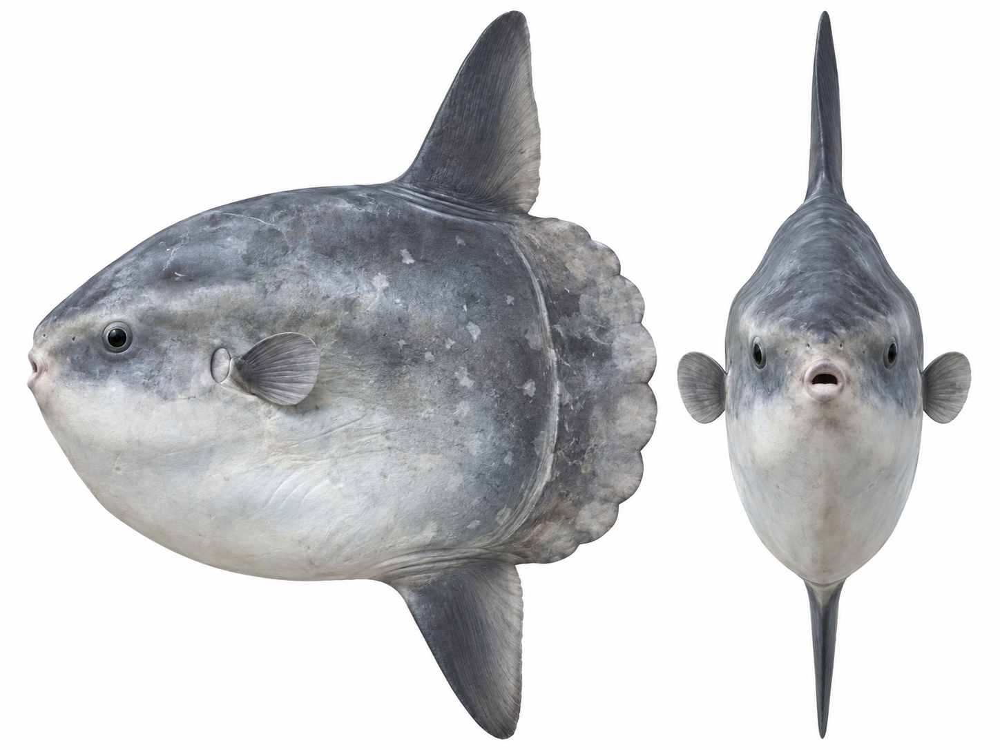
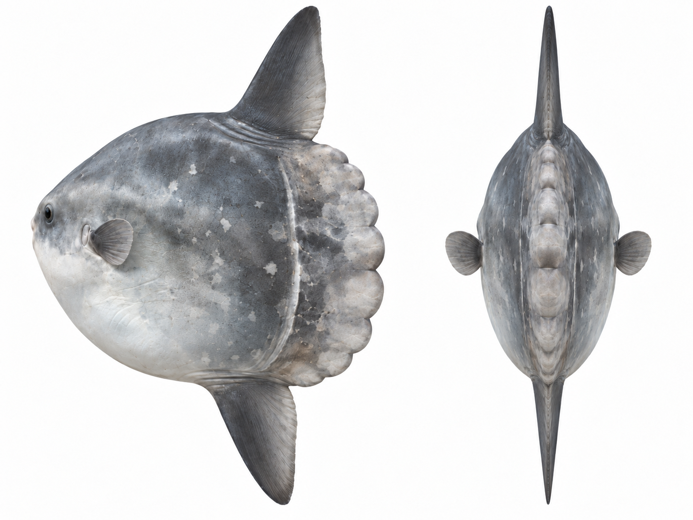
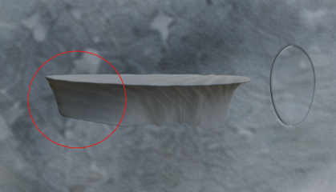

# マンボウの3Dモデル制作ログ

2026年10月8日〜11月5日の制作記録から、形状、変形、配布の順に、指示と作業結果を整理した。「当時の指示」は原文の抜粋。「完成形から逆算した指示」は、何度か調整して得られた形や動きを最初の依頼で伝えられるように書き起こした。結果欄の数値は各工程で報告された検証結果に基づく。

## 1. 正面と側面の輪郭を合わせ、仮リグで曲げる

10月13日のモデリングで参照した図版。正面図で胴体の幅や目と口の位置を、側面図で輪郭と鰭の位置を、背面図で舵鰭の厚みや左右の胸鰭の位置を見比べられる。

参考図版2枚を表示

**当時の指示（10月13日）**

> イラストを参考に、Blenderでマンボウの3Dモデルを1から作成してください。\
> 【全体】\
> ・正面と横から見た輪郭を原画に合わせる\
> ・左右対称部分にはMirror Modifierを使う\
> ・原画からテクスチャをベイクし、必要に応じて画像生成でテクスチャを作成する\
> ・ボーン自体も早い段階で仮置きし、根元が潰れるといった問題に早めに対処する

背鰭・臀鰭の指示では、根元の作り方と曲がる方向も指定した。

> ・鰭の根元から先端まで滑らかに曲げられるトポロジーにする\
> ・根元付近にも十分なエッジループを確保する\
> ・2〜3本のボーンで変形させることを想定する\
> ・胴体との接続部分で不自然な折れが発生しない形状にする\
> ・左右方向へのしなりを主な変形方向とする

**結果**　胴体の Root 1本、背鰭と臀鰭に各3本、左右の胸鰭に各2本、舵鰭に2本の計13本で試した。輪郭の重なりは側面で約95％、正面で約93％。初版から鰭を左右に曲げて、付け根の面積変化やウェイトを確認できた。

## 2. 口と鰓を胴体の形として作る

**完成形から逆算した指示**

> 胴体のメッシュに口裂と唇を作ってください。正面画の口の中に見える白い部分は舌です。舌は別オブジェクトにして、`Mouth_Open` で口を上下に広げたときに見えるようにしてください。
>
> 唇のすぐ手前だけを平らにし、吻の丸みが額・顎・左右の頬へ滑らかにつながるようにしてください。眼球も別オブジェクトにして、白目が見えるように頭部の表面から少し出してください。
>
> 胸鰭のすぐ前に、胴体表面に沿った浅く細長い鰓孔を作ってください。`Gill_Open` を動かすと開口がわずかに広がるようにしてください。

**結果**　`Mouth_Open` と `Gill_Open` で変形を調整できるようにした。吻の修正では、唇の形や口の初期姿勢を保ちつつ、口先から頬にかけての曲面を直した。

## 3. ボーンの軸と限界姿勢を確認してから泳ぎを作る

**当時の指示（10月15〜16日）**

> 各可動部について、\
> ・ローカル座標軸\
> ・主に回転させるべき軸\
> ・現在のボーン階層\
> を確認してください。

> 次の段階として、まだ自動泳動やアニメーションは作成せず、\
> まずFK操作と回転制限だけ実装してください。
>
> ・現在の13本の変形ボーンとウェイトは変更しない\
> ・既存のXYZ Eulerを維持する\
> ・Limit RotationをLocal Spaceで設定する\
> ・監査結果の初期角度を使用する\
> ・鰭ボーンのLocationとScaleをロックする\
> ・Rootは全体移動・回転用として制限しない\
> ・現在の検証用Actionは変更・削除しない

**結果**　細分化後の50姿勢を検査し、胸鰭の限界姿勢で根元に最大約11 mmの埋没を確認した。巡航の試作に進み、実写を見直した段階で支点とウェイトを調整した。

## 4. 実写から胸鰭の支点と閉じる動きを読み取る

**完成形から逆算した指示**

> まず制作原本で胸鰭の取り付け位置を上げ、付け根を胴体表面に沿わせてください。この段階では位置と向きを決め、動きはその形に合わせて作ってください。
>
> 胸鰭の開閉が映る動画の2〜3秒付近を確認してください。胸鰭の下側に支点を置き、付け根のボーンのローカルX軸を主な回転軸にしてください。片側4本の主ボーンでしなりを分け、根元から2本目にもわずかに回転を入れてください。補助ボーンを左右に1本ずつ置き、閉じるときは鰓側の付け根が胴体に沿ったまま、後ろ側の縁だけが少し浮くようにしてください。
>
> 実写と同じ角度で見比べて、閉じた胸鰭がほぼ縁だけに見えるよう、中央から先端の向きを調整してください。閉じてから開き直すまでの間も動画に合わせてください。

**結果**　取り付け位置を上げて胴体表面に沿わせた。2本と4本のボーンで試し、曲げを分散できる4本構成を採用した。中央から先端の向きを変えて閉じた鰭が縁に近く見えるようにし、閉じた状態を約0.2秒長く保つようにした。左右に補助ボーンを1本ずつ追加し、鰓側の付け根を保ちながら後縁だけが少し離れる形にした。

レビュー時のスクリーンショット。赤丸は、胸鰭を閉じたときに胴体から少し離す後縁を示している。

## 5. 鰓の開口と膜の張りを分ける

**完成形から逆算した指示**

> 鰓弁を、半分に切ったトランポリンのように膜全体がたわむ形にしてください。胸鰭側の縁の開きは `Gill_Open`、膜全体のへこみと膨らみは `Gill_Bulge` で別々に操作できるようにしてください。
>
> 巡航中は両方が `0` の中立姿勢から始め、鰓を閉じたまま `Gill_Bulge` を `-1` にして少し待ってください。いったん中立に戻したあと、`Gill_Open` と `Gill_Bulge` を一緒に `1` まで上げ、開いて膨らんだ状態で少し待ってから中立に戻してください。鰓は7秒、鰭は3秒の独立した周期で動かし、21秒でつながるループにしてください。

**結果**　`Gill_Open` で開口を、`Gill_Bulge` で膜の張りを操作する構成にした。鰭を3秒、鰓を7秒で繰り返し、両方が初期状態に戻る21秒を巡航ループにした。

11月2日の[鰓弁の比較レンダー](images/sunfish-gill-comparison.png)は、上段が閉じた状態、下段が開いた状態。左が材質の調整前、右が調整後で、鰓弁の色が周囲の肌になじむ様子を見比べられる。

## 6. 一通り形ができたモデルを実物と見比べる（11月2日）

マンボウの形が一通りできた段階で、モデルを実物と見比べ、形や部位のつながりに違和感がないかを確かめた。レビューでは、胴体の厚み、背鰭・臀鰭で泳ぐ体型、舵鰭のある輪郭、灰白色のまだらな表皮はマンボウらしいと評価された。修正は胸鰭の付け根が最優先だった。

> ただ、**胸鰭は少し浮いて見えます**。位置そのものより、「胴体との接続の仕方」が原因だと思います。

**レビューで挙がった修正案**

- **胸鰭**は薄い扇形が胴体表面から急に始まるため、貼り付けたように見えた。付け根の約4分の1を埋め込む感覚で接合部を丸め、胴体の盛り上がりから鰭膜へ滑らかにつなぐ。鰭全体は少し外側と上へ起こす。
- **背鰭・臀鰭**は尖った三角形に見えた。根元に厚みを持たせ、特に背鰭は前縁から先端にかけて丸める。
- **舵鰭**は一つひとつの膨らみが独立して見えた。谷を浅くして膨らみをつなげ、一枚の厚い板の縁が波打つ形に近づける。
- **口と鰓孔**は、鼻先の小さな口裂がわずかに見え、胸鰭の前の鰓孔は肌に沿った小さなくぼみとして見えるようにする。

[修正前後の比較レンダー](images/sunfish-shape-comparison.png)は、左が修正前、右が修正後のモデル。上段では背鰭・臀鰭を含む側面の輪郭、中段では胸鰭と胴体のつながり、下段では舵鰭の波形を見比べられる。

## 7. 法線・UV・Material を点検する

**確認時の指示（共有された文面）**

> 現在のモデルについて、UV・法線・Materialの状態を確認してください。
>
> 【法線】\
> ・反転面がないか\
> ・法線方向が不自然な箇所がないか\
> ・鰭の根元や薄い部分で陰影破綻がないか\
> ・スムージングによってシルエットや接続部に不自然な陰影が出ないか
>
> 【UV】\
> ・UV未展開の面がないか\
> ・意図しない重なりがないか\
> ・著しい伸びや潰れがないか\
> ・左右ミラー部分のUVが意図した構成になっているか\
> ・顔、目、鰓孔、各鰭など重要部位に極端な解像度不足がないか
>
> 【Material】\
> ・不要なMaterial Slotがないか\
> ・重複マテリアルがないか\
> ・面への割り当てミスがないか\
> ・ゲーム用途として不必要に複雑なノード構成になっていないか
>
> 問題があれば、\
> 「修正必須」「後で対応可」「問題なし」\
> の3段階で分類して報告してください。

## 8. 小さく試験出力し、軽量版の変形を照合する

**完成形から逆算した指示**

> 軽量化に着手する前に、Mirror と Shape Key を使った小さな試験モデルを GLB に書き出してください。ブラウザーで読み込み、左右対称の形と口・鰓の変形が残っていることを確認してください。
>
> 承認済みの制作原本を比較の基準にして、調整は軽量版側で行ってください。胸鰭は表・裏・縁の UV と、しなりに必要な格子を保ってください。巡航中や関節の限界姿勢で形を比較し、閉じる途中で胸鰭の表面に差が出る場合は、左右それぞれの補正モーフで合わせてください。
>
> 補正した動きを通常版と圧縮版の両方に入れてください。両方の GLB をブラウザーで開き、巡航、口と鰓の操作、回転の限界姿勢で同じ変形になることを確認してください。

**結果（11月5日）**　当時のデモは87,188三角形、19ボーン。胸鰭では表・裏・縁の UV と変形に必要な格子を保ち、軽量版に左右別の補正モーフを追加した。巡航と関節の限界を含む36姿勢の比較で、胸鰭のサンプル点における表面差は最大約4.92 mmから約0.75 mmに縮まった。通常版と圧縮版には同じ変形を収録した。

### 11月10日の公開用モデル差し替え

公開用デモを、胸鰭が左右各2本、全体で13本のボーンを持つ版に差し替えた。87,188三角形で、鰭3秒・鰓7秒を組み合わせた21秒の巡航ループを収録している。通常・圧縮 GLB、制限姿勢データ、復習用 Blender ファイルをこの版にそろえた。
